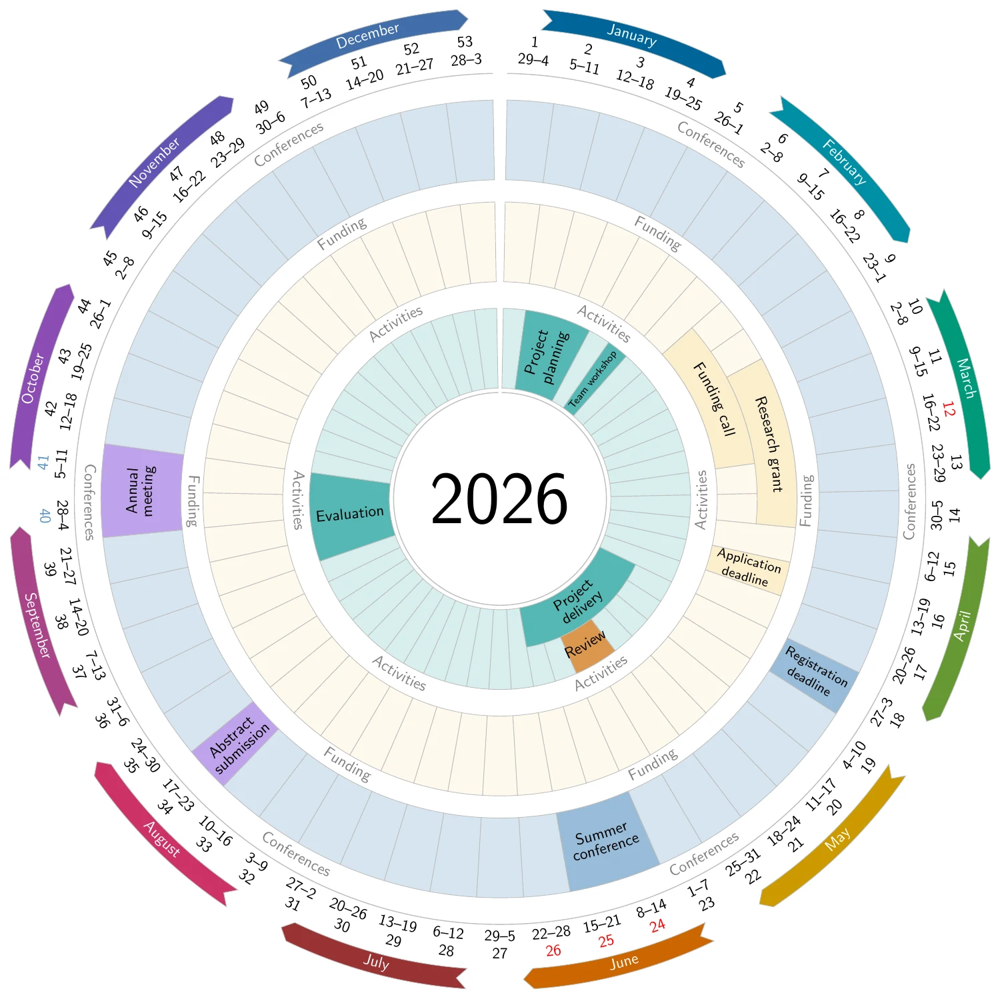
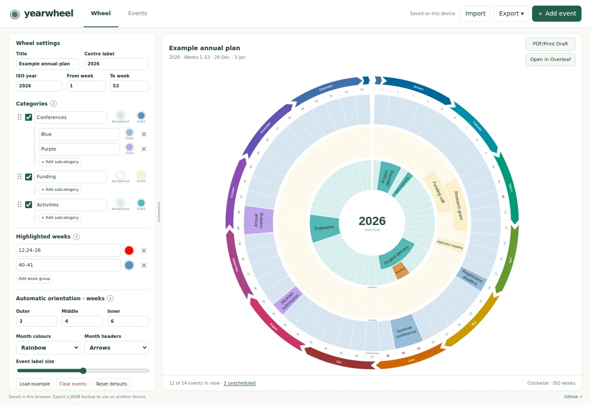

# Yearwheel JS

Create an annual plan with editable category rings, ISO weeks, and a live wheel preview.

**[Open Yearwheel →](https://sebastiankrog.github.io/yearwheel-js/)**

**Final wheel — LaTeX / Overleaf output**



**Editor preview**



## Use it

1. Choose a year and **Load example**, add events, or import a CSV/JSON file.
2. Edit categories, colours and highlighted weeks beside the wheel. Drag category handles to reorder rings from outside to inside.
3. Use the **Events** tab to search and edit events. Double-click a table field for a quick edit.
4. Choose **Open in Overleaf** for the final LaTeX render, or **PDF/Print Draft** for a browser draft.

Plans save in your browser. Export a **Complete project (.json)** backup to keep your events and settings or move them to another device.

## Customise the wheel

- Use two or three rings, with optional subcategories. Each category has a background and event colour; subcategories have an event colour. Disabling a category hides its events from the wheel and keeps them in the list.
- Adjust month colours, arrow/plain headers, label size and automatic text orientation. Individual events can override orientation.
- Highlight weeks in separate colour groups, using entries such as `12, 24–28`, `15/6`, or `1/6 to 15/6`. Periods include both endpoints; later groups override earlier ones.
- Resize the settings panel by dragging its divider. Info circles explain individual controls.

## Import events

CSV columns:

| Column | Value |
| --- | --- |
| `name` | Event label; required |
| `category` | Category name or ID; blank uses the first enabled category |
| `subcategory` | Optional subcategory name or ID |
| `start` | ISO week number or date |
| `end` | Inclusive end; blank uses the start week |
| `color` | Blank to inherit, or a colour name/hex value |
| `notes` | Optional notes; excluded from wheel labels |

Leave **both weeks blank** for an unscheduled event. Dates accept `D/M`, `D/M/YYYY` or `YYYY/M/D`, with `/`, `-` or `.` separators. Missing years use the wheel year; event dates must belong to that ISO year. In highlighted weeks, `2-5` means weeks 2–5; use `2/5` for 2 May.

Imports replace existing events by default, with confirmation. Uncheck **Replace** to append. Use **Import → Download CSV template** for a sample; legacy `date`, `end_date` and `duration_weeks` columns also work.

## Export

**Open in Overleaf** creates a new project from the current `.tex` source. Compile with **pdfLaTeX** for the final wheelchart layout. The SVG is an interactive overview; **PDF/Print Draft** uses browser printing. CSV exports events; JSON includes the complete plan and settings.

## Run locally

No build step or dependencies are needed to serve the app:

```sh
python3 -m http.server 8000 --directory dist
```

Open <http://localhost:8000>. Run checks with:

```sh
node --check dist/app.js
node tests/regression.cjs
```

Pushes to `main` run checks and publish `dist/` to GitHub Pages. Set **Settings → Pages → Source** to **GitHub Actions**.
